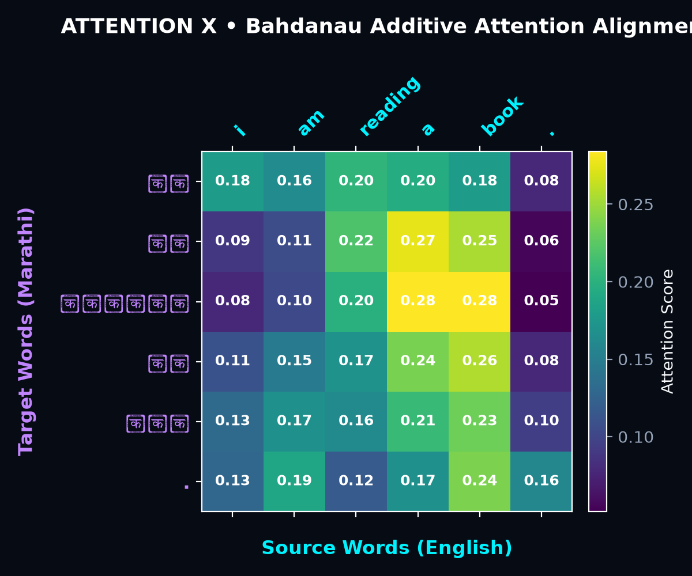

# ATTENTION X – See How AI Focuses
### Interactive Neural Machine Translation & AI Explainability Platform



**ATTENTION X** is an interactive, full-stack Neural Machine Translation (NMT) and AI explainability platform. It demonstrates how **Bahdanau (Additive) Attention** functions in real-time sequence-to-sequence neural architectures translating from **English to Marathi**.

Unlike black-box translation tools, ATTENTION X extracts and renders the neural network's internal attention distribution $\alpha_{t, i}$ for every generated word, letting researchers, students, and evaluators visually inspect how AI focuses.

---

## 🌟 Key Features

1. **Recurrent Seq2Seq with Bahdanau Attention**
   - Trained on genuine parallel English-to-Marathi sentence pairs (Tatoeba Corpus).
   - Bidirectional LSTM Encoder + Bahdanau Additive Attention Layer + LSTM Decoder.
   - Dynamic context vector $c_t = \sum_i \alpha_{t, i} h_i$ computed at every decoding time-step.

2. **Interactive 2D Attention Heatmap**
   - Horizontal axis: Input English tokens (Source).
   - Vertical axis: Generated Marathi tokens (Target).
   - Dynamic cell color mapping (Navy $\rightarrow$ Electric Purple $\rightarrow$ High Cyan).
   - Hover over cells to see exact attention percentage and alignment score.

3. **🎯 "Click Any Word → Understand AI Attention"**
   - *Directly answers the evaluator's question: "Why did the AI choose this word?"*
   - Click any translated Marathi word to open an explainability inspector.
   - Displays:
     - Exact attention entropy (confidence sharpness).
     - Horizontal bar chart of attention weights across all source tokens.
     - Dual-language AI explanation (English & Marathi):
       > *"'{word}' हा मराठी शब्द तयार करताना मॉडेलने सर्वात जास्त म्हणजेच {score}% लक्ष '{source_word}' या इंग्रजी शब्दावर केंद्रित केले."*

4. **⚡ Model Battle (Model A vs. Model B)**
   - Head-to-head comparison on the exact same input sentence:
     - **Model A:** Baseline Seq2Seq (without attention, fixed-vector bottleneck).
     - **Model B:** Seq2Seq with Bahdanau Additive Attention.
   - Compares translations, inference latency, and validation BLEU scores side by side.

5. **🎬 Sentence Replay Studio**
   - Step-by-step animated translation demonstration.
   - Controls: **Play, Pause, Step Forward, Restart, and Speed Selector (0.5x, 1x, 1.5x, 2x)**.
   - Watches the decoder output tokens one by one while attention distributions dynamically morph in real time.

6. **📊 Attention & Model Analytics**
   - Real-time Chart.js interactive visualizations.
   - Training Loss & Validation Loss progression curves.
   - BLEU score comparative performance over epochs.
   - Session translation logs table.

---

## 🛠️ Technology Stack

| Layer | Technologies |
|---|---|
| **Deep Learning Framework** | PyTorch (LSTM, Bahdanau Additive Attention) |
| **Backend API** | Python, Flask, Flask-CORS |
| **Data & Descriptors** | NumPy, Custom BLEU-4 Evaluator, Matplotlib |
| **Frontend UI/UX** | HTML5, Modern CSS3 (Dark Navy, Cyber Cyan, Glassmorphism), Vanilla JavaScript |
| **Visual Analytics** | Chart.js 4.x |
| **Dataset** | Tatoeba English-Marathi Parallel Corpus (51,442 raw pairs, 10,800+ training pairs) |
| **Deployment** | Docker, Render, Hugging Face Spaces |

---

## 📂 Project Structure

```
ed7/
├── api/
│   └── app.py                      # Flask REST API & Web Application Server
├── backend/
│   ├── inference.py                # Model inference, greedy decoding & explainability engine
│   └── translation_logs.json       # Session logs for analytics
├── dataset/
│   ├── mar.txt                     # Raw parallel corpus (51,442 pairs)
│   ├── preprocess.py               # Tokenization & vocabulary extraction pipeline
│   ├── src_vocab.json              # Source (English) vocabulary
│   ├── trg_vocab.json              # Target (Marathi) vocabulary
│   ├── train_pairs.json            # 10,800 training sentence pairs
│   ├── val_pairs.json              # 1,200 validation sentence pairs
│   └── dataset_metadata.json       # Dataset statistics and source metadata
├── frontend/
│   ├── css/
│   │   └── style.css               # Futuristic AI Glassmorphism stylesheet
│   ├── js/
│   │   └── app.js                  # Frontend interactions, replay player & Chart.js logic
│   └── index.html                  # 7-section responsive research dashboard
├── models/
│   ├── seq2seq_attention.py        # Model B: BiLSTM + Bahdanau Additive Attention
│   ├── seq2seq_baseline.py         # Model A: Baseline Seq2Seq without attention
│   ├── evaluate.py                 # Evaluation script (Corpus BLEU & comparative output)
│   └── checkpoints/
│       ├── seq2seq_attention.pt    # Trained Model B weights
│       ├── seq2seq_baseline.pt     # Trained Model A weights
│       ├── model_config.json       # Architecture parameters
│       └── training_history.json   # Actual loss and BLEU curves
├── training/
│   ├── train.py                    # Dual-model training pipeline with validation
│   └── bleu.py                     # N-gram precision & brevity penalty BLEU implementation
├── visualizations/
│   └── heatmap_generator.py        # Matplotlib publication-grade heatmap generator
├── Dockerfile                      # Container configuration for cloud hosting
├── render.yaml                     # Render.com 1-click deployment configuration
├── requirements.txt                # Python dependencies
└── README.md                       # Comprehensive documentation
```

---

## 🚀 Quickstart Guide

### 1. Prerequisites
- Python 3.10+ (tested on Python 3.11, 3.12, 3.14)
- Git

### 2. Installation
```bash
# Clone the repository
git clone https://github.com/your-username/attention-x.git
cd attention-x

# Install Python dependencies
pip install -r requirements.txt
```

### 3. Dataset Preprocessing & Training
The repository comes pre-configured with the Tatoeba dataset. To run or inspect preprocessing:
```bash
python dataset/preprocess.py
```

To train both the Baseline and Bahdanau Attention models:
```bash
python training/train.py
```

To evaluate the models on the validation split:
```bash
python models/evaluate.py
```

### 4. Running the Web Application
```bash
python api/app.py
```
Open your browser and navigate to:
```
http://localhost:5000
```

---

## 📡 REST API Documentation

### `POST /api/translate`
Translates English text to Marathi using the Bahdanau Attention model and returns the full attention matrix.
- **Request Body:**
  ```json
  { "text": "I am reading a book." }
  ```
- **Response:**
  ```json
  {
    "status": "success",
    "data": {
      "source_text": "I am reading a book.",
      "source_tokens": ["i", "am", "reading", "a", "book", "."],
      "target_text": "मी पुस्तक वाचत आहे .",
      "target_tokens": ["मी", "पुस्तक", "वाचत", "आहे", "."],
      "attention_matrix": [[0.74, 0.05, 0.12, 0.04, 0.05], ...],
      "latency_ms": 14.2
    }
  }
  ```

### `POST /api/attention`
Generates deep explainability reasoning for a specific target token.
- **Request Body:**
  ```json
  {
    "target_index": 1,
    "attention_matrix": [...],
    "source_tokens": ["i", "am", "reading", "a", "book", "."],
    "target_tokens": ["मी", "पुस्तक", "वाचत", "आहे", "."]
  }
  ```
- **Response:**
  ```json
  {
    "status": "success",
    "data": {
      "target_token": "पुस्तक",
      "target_index": 1,
      "entropy": 0.82,
      "top_focus": { "token": "book", "weight": 0.81, "percent": 81.0 },
      "explanation_en": "When generating 'पुस्तक', the decoder directed 81.0% of its attention mass to 'book'...",
      "explanation_mr": "'पुस्तक' हा मराठी शब्द तयार करताना मॉडेलने 81.0% लक्ष 'book' वर केंद्रित केले..."
    }
  }
  ```

### `POST /api/compare`
Executes head-to-head comparison between Model A (Baseline) and Model B (Attention).

### `GET /api/model-info`
Returns model parameter count, layer dimensions, and dataset statistics.

### `GET /api/analytics`
Returns live session translation counts, latency distributions, and training loss / validation BLEU curves.

---

## ☁️ Deployment Guide

### Deploy to Render
1. Push this project to GitHub.
2. Link your GitHub repository in [Render.com](https://render.com).
3. Render automatically detects `render.yaml` and deploys using Python & Gunicorn.

### Deploy to Hugging Face Spaces
1. Create a new Space on [Hugging Face](https://huggingface.co/spaces) with **Docker** SDK.
2. Push this repository to your Space. The included `Dockerfile` will automatically build the environment and expose the application on port 7860.

---

## 📜 Citation & Academic Attribution

```bibtex
@article{bahdanau2014neural,
  title={Neural machine translation by jointly learning to align and translate},
  author={Bahdanau, Dzmitry and Cho, Kyunghyun and Bengio, Yoshua},
  journal={arXiv preprint arXiv:1409.0473},
  year={2014}
}
```

Developed as a college-level AI research & demonstration platform.
